# Rex Rumble

**You are a T. rex with very short arms, and six floors of the prehistoric world want you gone.**

### [Play it in your browser](https://richdurham.github.io/dino_doom/)

No install, no sign-up. It runs on a laptop, a tablet or a phone, and it works offline too: download `rex-rumble.html` and double-click it.

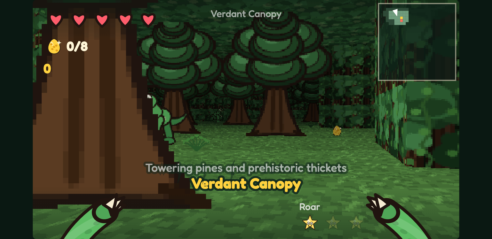

Rex Rumble is a retro first-person action game in the spirit of *Wolfenstein 3D* and *Doom*, except that you are the dinosaur. Claw, bite and roar your way through forests, swamps, lava caves and a golden throne room, find the eggs, scare off everything that hunts you, and reach the green footprint that leads down to the next floor. Then build your own floors in the level editor that comes with it.

---

## How to play

Every dino flashes **red** while it winds up an attack. Step out of its line, then punish it.

- **Claw** is fast and wide. It hits up to three dinos at once, and lands early enough to knock a dino off a strike it has already started.
- **Bite** is slow and roots you to the spot, but it does **double damage** to a dino already committed to its own move. Biting into the red flash beats swinging on reflex.
- **Roar** freezes every dino near you. You carry up to three; stars give you more.
- **Golden eggs** are points, and each floor hides most of them: in thickets, in alcoves off the main path, or under guard. **Meat** heals you. The **green footprint** is the way out, though on some floors it only appears once the boss is beaten.

| Action | Keyboard and mouse | Touch (phone and tablet) |
| :--- | :--- | :--- |
| Move and strafe | `W` `A` `S` `D` (`↑` `↓` also walk) | Drag anywhere on the left half; a stick appears under your thumb |
| Turn | Move the mouse, or `Q` / `E` (`←` / `→` also turn) | Drag on the right half |
| Look up and down | Move the mouse, `PageUp` / `PageDown`, `I` / `K` (`Home` re-centres) | Drag up or down on the right half |
| Claw | Left click or `F` | **Claw** button |
| Bite | Right click or `Space` | **Bite** button |
| Roar | `R` or `Shift` | **Roar** button |
| Pause and level editor | `Esc` or `P` | **II** button, top left |
| Music on and off | `M` | Pause menu |

The game switches between touch and mouse controls as you use them, so a touch-screen laptop works either way. On a tablet or phone, turn it sideways and use **Full Window** on the web page for the biggest view.

---

## The dinosaurs

Every dino is drawn from the front, the side and behind, so you can tell at a glance which way it's facing, and whether it's about to come for you.

<table>
<tr>
<td width="160" align="center">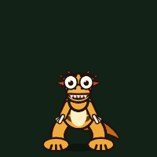</td>
<td><b>Velociraptor</b><br>Amber, tiger-striped pack hunters with a red crest. The first one to spot you screeches for the rest, and the pack fans out to come at you from different sides. Each one crouches, springs, slashes and immediately backs out of reach, so keep turning.</td>
</tr>
<tr>
<td align="center">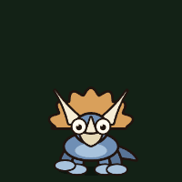</td>
<td><b>Triceratops</b><br>Armoured and stubborn. It paws the ground along the line it's about to charge, which gives you seven tenths of a second to get off that line.</td>
</tr>
<tr>
<td align="center">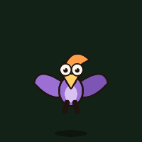</td>
<td><b>Pterosaur</b><br>Circles overhead, rears up with a screech, then dives at you in a straight line. Sidestep the dive.</td>
</tr>
<tr>
<td align="center">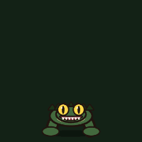</td>
<td><b>Borealosuchus</b><br>A crocodilian lurking in the bayou, with heavy jaws and armoured scales that are softest from behind. It coils before it snaps forward, so there is always a beat to step aside.</td>
</tr>
<tr>
<td align="center">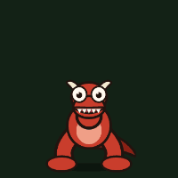</td>
<td><b>Carnotaurus</b> (sub-boss)<br>The horned guardian of the bayou's bone gate. It rears up with a bellow and keeps aiming for half a second before it commits to a charge. Break the line in that window and it thunders past.</td>
</tr>
<tr>
<td align="center">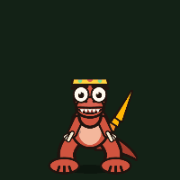</td>
<td><b>The Bone King</b> (boss)<br>The colossal ruler of the Bone Throne, with a huge reach and a crown-guard of dinos.</td>
</tr>
<tr>
<td align="center">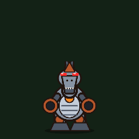</td>
<td><b>The Robo-Spinosaurus</b> (final boss)<br>A steel spinosaurus with a furnace for a heart and cannons for arms. When it <i>breathes in</i>, its belly and sail blaze and embers stream into its jaws: get behind a pillar before it roars and sweeps the arena with fire. Get too close and both cannons come up with a whine, then blast you across the room. Claw it during either wind-up to knock it off; bite it while it's breathing fire for double damage. Below half health it overheats and gets faster.</td>
</tr>
</table>

---

## Six floors

<table>
<tr>
<td width="50%">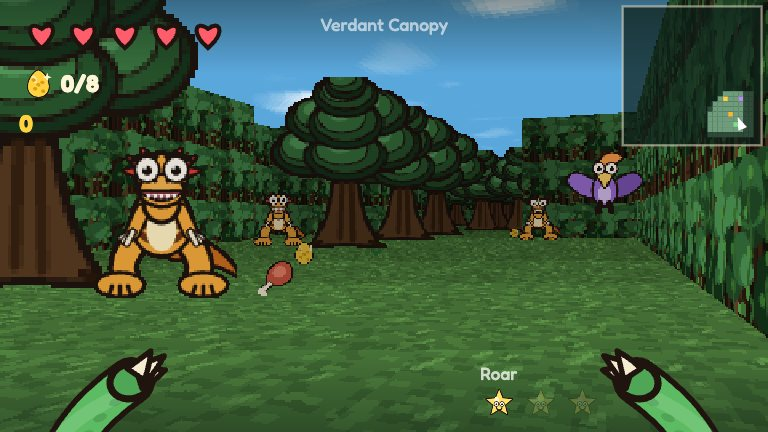<br><b>Verdant Canopy</b><br>Open primeval forest under a wide blue sky. The walls are trees, the doors are gaps in the thicket, and the eggs are tucked into nests.</td>
<td width="50%">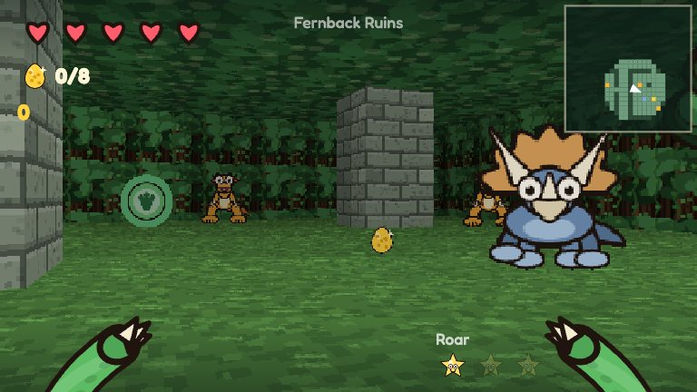<br><b>Fernback Ruins</b><br>Ancient stone pillars overgrown with pines and hanging vine curtains.</td>
</tr>
<tr>
<td>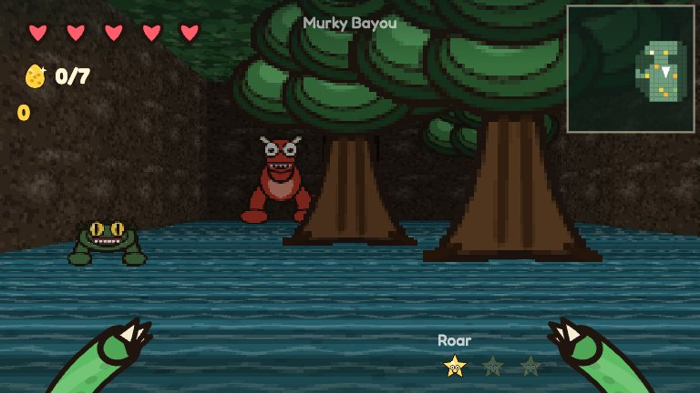<br><b>Murky Bayou</b><br>A cypress swamp with a bone gate, a fossil key, and the Carnotaurus standing guard. The way out only appears once it falls.</td>
<td>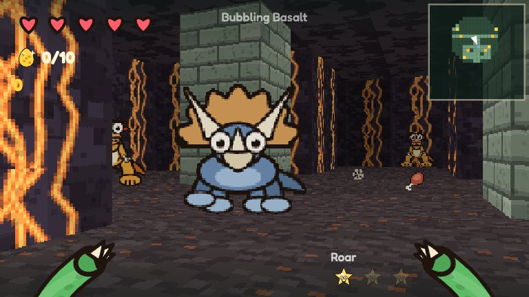<br><b>Bubbling Basalt</b><br>Volcanic caverns, ash floors, glowing lava walls, and a raptor pack that likes the heat.</td>
</tr>
<tr>
<td>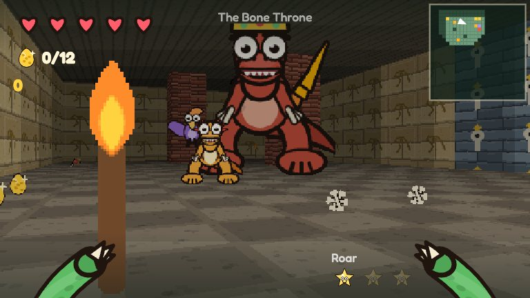<br><b>The Bone Throne</b><br>A golden temple arena, and the showdown with the Bone King.</td>
<td>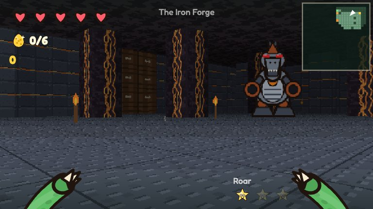<br><b>The Iron Forge</b><br>Riveted iron, steel floors and lava pillars to hide behind. The exit is sealed behind a key gate, and the Robo-Spinosaurus carries the key.</td>
</tr>
</table>

---

## Music and sound

All of it is synthesized live in your browser: there are no music files.

- **Every floor has its own soundtrack**, and every track builds while dinos are actually hunting you: new parts come in, and once the hunt is properly on the track speeds up a little. On the nature tracks the birds and frogs fall silent when something big is near.
- **A boss theme** takes over when a boss notices you, and builds as the boss weakens. Each boss adds its own colour: congas for the Carnotaurus, a temple bell and choir for the Bone King, an anvil and steam for the Robo-Spinosaurus. When it falls, there are a few seconds of quiet before the floor's own music comes back.
- **The places make their own sounds.** Lava roars and bubbles, iron plating hums and clanks, mud walls gurgle and hide frogs, trees and vines rustle, gold walls ring faintly, and water laps around you. Each sound gets louder the closer you are, comes from the side its source is on, and is muffled by walls in between.

| Track | Mood | Plays on |
| :--- | :--- | :--- |
| **Jungle Drums** | Congas, clave and a marimba under the canopy, a wooden flute, birds overhead | Verdant Canopy |
| **Misty Ferns** | Ambient: slow pads, a kalimba wandering in the echo, wind, crickets, something huge calling far off | Fernback Ruins |
| **Bayou Haze** | A slow swampy shuffle: upright bass, a dobro on the blues scale, bullfrogs and cicadas | Murky Bayou |
| **Magma Chamber** | A deep rumble, taiko drums, a distorted riff, bubbling lava and steam | Bubbling Basalt |
| **Sunken Temple** | Ancient magic: a droning tanpura, temple bells, a ritual drum, a choir and a snake-charmer reed | The Bone Throne |
| **Iron Forge** | Pistons, a hammer on the anvil, clockwork and a growling bass | The Iron Forge |
| **Apex Predator** | The boss fight: pounding drums, brass stabs and a horn theme | Any floor, once a boss notices you |
| **Rex Riff** | The original stomp: a bass riff, a drum kit and a square-wave tune | Pick it in the editor |
| **Silence** | No music, just the dinos | Pick it in the editor |

---

## Build your own floors

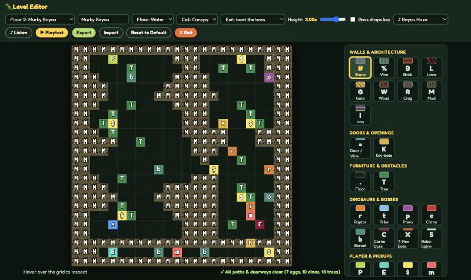

The level editor is built into the game. Open it from the title screen, or press `Esc` while playing and choose **Edit this floor**.

- **Paint** walls, doors, trees, dinos, bosses, eggs, keys and pickups onto the 24×24 grid, with a mouse or a finger.
- **Set the mood**: floor and ceiling textures (grass, water, ash, temple tile, steel; open sky, forest canopy, cave or gold), the ceiling height, and the floor's music. Press **Listen** to hear a track right there: it plays calm for 20 seconds, then the way it sounds when dinos are hunting you. The tiles bring their own sounds with them, so painting lava gives you lava to hear.
- **Choose the exit's goal**: the footprint can be there from the start, or appear only once you beat the boss, scare off every dino, or find every egg. Tick **Boss drops key** and the last boss drops the key for the floor's key gates.
- **It checks your work** as you paint: a tree plugging a one-tile passage, an exit you can't reach, a walled-in boss, an unreachable egg, or a key locked behind its own gate.
- **Playtest** in one click. **Export** a floor as JSON to share it, and **Import** one someone sent you. Your changes are saved in your browser, and **Reset to Default** brings back the original floor.

---

## Under the hood

The whole game is one self-contained HTML file: plain JavaScript and HTML5 Canvas, no frameworks, no build step and no downloads at runtime. The rounded *Fredoka* font and the roar sample are embedded in it.

- **A 2.5D raycaster** in the *Wolfenstein* tradition, with textured floors and ceilings, per-floor ceiling heights (`1.0x` up to the throne room's `3.2x`), full vertical look, and a sky that wraps seamlessly.
- **Procedural art**: every texture and sprite is drawn in code when the game starts.
- **Procedural audio**: Web Audio oscillators, filtered noise, a generated reverb, a tempo-synced echo and a soft clipper make every effect, the ambience and all nine soundtracks.

### Checks

The game has no dependencies, and neither do its checks:

```sh
node tools/check.js
```

It parses every inline script, boots the game headlessly (`tools/harness.js` stubs the DOM, the 2D canvas and Web Audio), runs **the in-game editor's own audit** over all six shipped floors, and plays 900 frames on each one with every dino awake, watching for exceptions, NaNs, and anything clipping out of the grid. It also plays every soundtrack calm and hunted (the Web Audio stub throws on a non-finite pitch or a ramp to zero, the way a browser does), checks the tempo only changes on a bar line, checks a boss brings its theme in and hands back to the floor's, and checks each floor's sounds are louder up close and swap sides when you turn round.

The floor audit calls `getEditorValidation()` rather than reimplementing its rules, so it can't drift from what the editor tells you when you build a level yourself. GitHub Actions runs the same command on every pull request.

---

## Credits

- [Fredoka](https://github.com/hafontia/Fredoka-One) by The Fredoka Project Authors, licensed under the [SIL Open Font License 1.1](fonts/OFL.txt). A Latin subset (`fonts/Fredoka.woff2`) is embedded in `rex-rumble.html`.
- The dinosaur roar is adapted from [BESTROFLMAN on FreeSound](https://freesound.org/people/BESTROFLMAN/sounds/212433/), licensed [CC BY 3.0](https://creativecommons.org/licenses/by/3.0/).
- Everything else you hear is synthesized in real time.

## License

MIT. Remix it, build custom floors, and expand the dinosaur kingdom.
